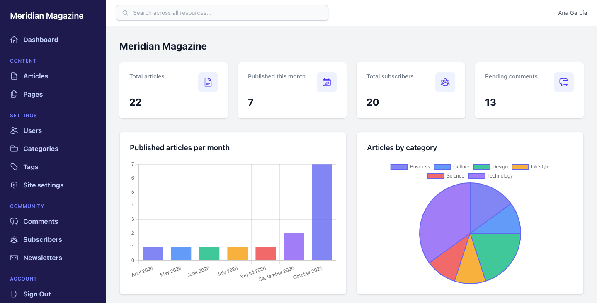
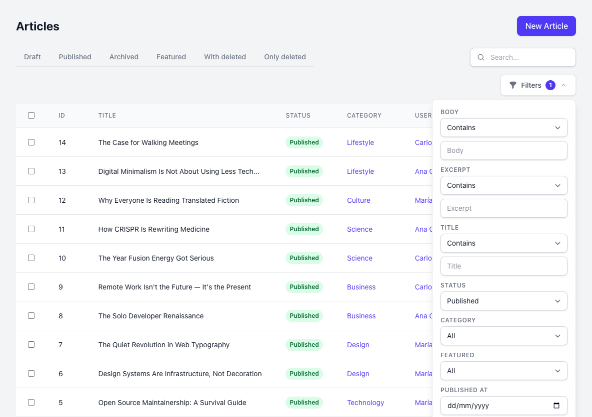
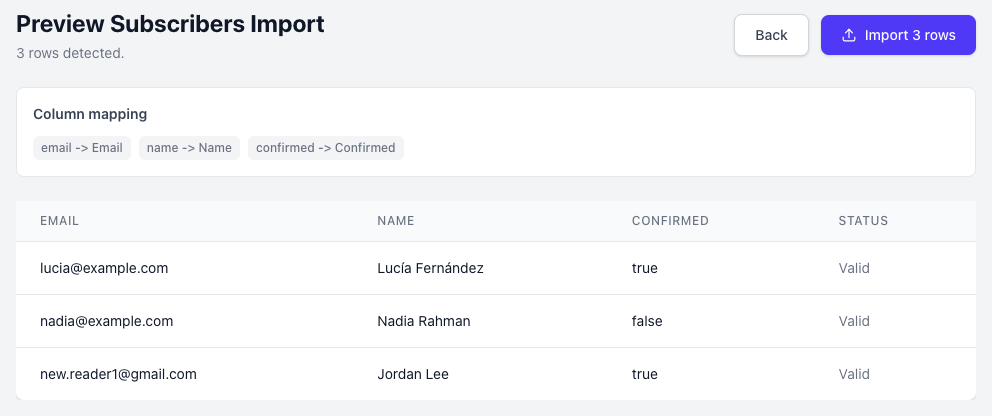
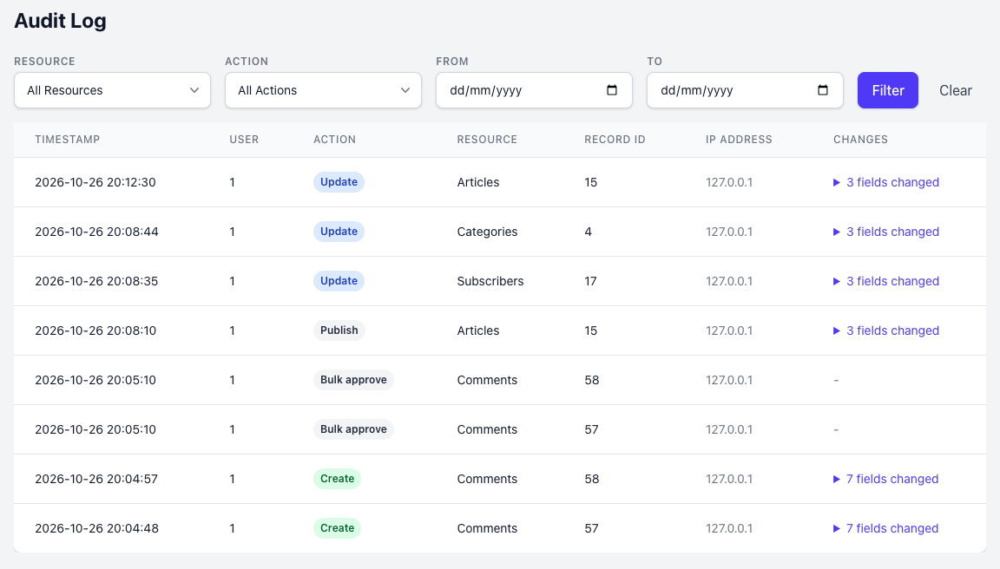
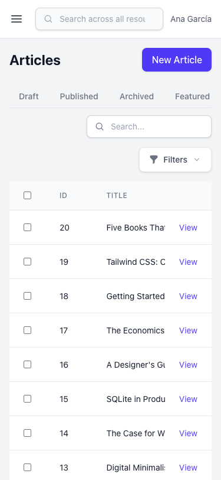
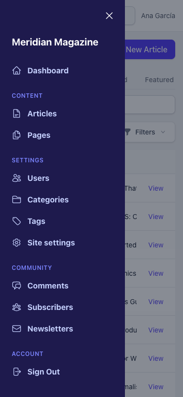

<h1 align="center">Meridian Magazine</h1>

<p align="center">
  <strong>The demo app for <a href="https://github.com/rubylab-app/iron_admin">IronAdmin</a>, the convention-over-configuration admin panel engine for Ruby on Rails.</strong><br>
  A magazine back office with articles, pages, comments, subscribers and newsletters, plus role-based policies, imports, an audit log and a mobile layout, built from nine small resource classes.
</p>

<p align="center">
  <a href="https://rubygems.org/gems/iron_admin"></a>
  <a href=".ruby-version"></a>
  <a href="Gemfile.lock"></a>
</p>

<p align="center">
  <a href="https://demo.ironadmin.rubylab.app/"><strong>Live demo</strong></a>
  &nbsp;·&nbsp;
  <a href="https://github.com/rubylab-app/iron_admin">IronAdmin on GitHub</a>
  &nbsp;·&nbsp;
  <a href="https://rubylab-app.github.io/iron_admin/">Documentation</a>
  &nbsp;·&nbsp;
  <a href="https://rubygems.org/gems/iron_admin">RubyGems</a>
</p>

<p align="center">
  <a href="https://demo.ironadmin.rubylab.app/">
    
  </a>
</p>

Meridian Magazine is a fictional online publication. In this repository, its whole admin, from the dashboard to the audit log, comes from IronAdmin 0.7.0 and about 390 lines of Ruby (blank lines and comments not counted): nine resource classes, one dashboard, one tool and an initializer. There are no admin controllers in this repository, and the only admin view is the Sign Out tool's page.

- [Try it live](#try-it-live)
- [Screenshots](#screenshots)
- [What this demo shows](#what-this-demo-shows)
- [Run it locally](#run-it-locally)
- [How it's built](#how-its-built)
- [Deploy with Kamal](#deploy-with-kamal)
- [Use IronAdmin in your own app](#use-ironadmin-in-your-own-app)

---

## Try it live

Open **[demo.ironadmin.rubylab.app](https://demo.ironadmin.rubylab.app/)** and pick a user. There are no passwords. Each user has a different role, so sign out (**Account → Sign Out** in the sidebar) and try the others.

> [!NOTE]
> The live demo is deployed separately from this repository (nothing deploys it on push), so it can run an older IronAdmin release than the code here. To see everything this README describes, [run it locally](#run-it-locally).

| User | Role | Content<sup>1</sup> | Users | Site settings |
|------|------|---------------------|-------|---------------|
| **Ana García**<br>`ana@meridian.com` | `admin` | Full access | View, create, edit, delete, activate and deactivate | View and edit |
| **Carlos López**<br>`carlos@meridian.com` | `editor` | Full access | View, create and edit | View only |
| **María Torres**<br>`maria@meridian.com` | `author` | Full access | View only | View only |

<sup>1</sup> Articles, pages, comments, categories, tags, subscribers and newsletters have no policy, so every user can create, edit, delete, import into and run actions on them. The role rules live in [`UserResource`](app/iron_admin/resources/user_resource.rb) and [`SiteSettingResource`](app/iron_admin/resources/site_setting_resource.rb). Two rules apply to everyone: newsletters and site settings cannot be deleted, and site settings cannot be created.

Every user can open the dashboard, the global search and the audit log at `/admin/audit`.

> Data on the live demo resets periodically, so feel free to create, edit, delete and import.

Things to try:

- Type `title:rails` in the Articles search box to search one field, or search every resource from the navbar.
- Open the **With deleted** and **Only deleted** tabs on Articles or Comments to see soft-deleted records.
- Download the subscriber list from `/admin/subscribers/export?format=csv` (or `?format=json`).

## Screenshots

<table>
  <tr>
    <td width="50%" valign="top">
      
      <br><sub><b>Articles:</b> scope tabs, status badges and operator filters</sub>
    </td>
    <td width="50%" valign="top">
      
      <br><sub><b>Import preview:</b> column mapping and per-row validation before saving</sub>
    </td>
  </tr>
  <tr>
    <td width="50%" valign="top">
      
      <br><sub><b>Audit log:</b> record changes, custom actions and bulk actions</sub>
    </td>
    <td width="50%" valign="top" align="center">
      
      
      <br><sub><b>Mobile:</b> the index and the off-canvas sidebar at 375 px</sub>
    </td>
  </tr>
</table>

## What this demo shows

Everything below is configured in this repository. Each section starts with links to the IronAdmin guides that cover it, as of the `v0.7.0` tag.

### Resources and fields

[Fields guide](https://github.com/rubylab-app/iron_admin/blob/v0.7.0/docs/guides/fields.md) · [Resources guide: fields](https://github.com/rubylab-app/iron_admin/blob/v0.7.0/docs/guides/resources.md#fields)

| Feature | Where in the demo |
|---------|-------------------|
| Fields inferred from the schema, overridden only where needed | All nine resources in [`app/iron_admin/resources/`](app/iron_admin/resources) |
| Badges with color maps | `status` on articles, pages, comments and newsletters, user `role`, site setting `setting_type` |
| Rich text editor (Trix) | Page `content` (Action Text `has_rich_text`); article `body` uses the same editor on a text column |
| File upload (Active Storage) | Article cover image, user avatar |
| Multiple file upload | Article gallery |
| Boolean fields | Article `featured`, user `active`, subscriber `confirmed` |
| Email and URL fields | User and subscriber `email`, comment `author_email`; user `avatar_url` (declared) and `website` (inferred from the column name) |
| Password field | User `api_token`: masked on the show page, never pre-filled in the form, left out of exports, `[FILTERED]` in the audit log |
| Color picker | Category `color` |
| Currency | Newsletter `sponsorship_amount` (`$`, two decimals) |
| Textarea | Article excerpt, user bio, page body, comment and newsletter body |
| Per-view field lists | `index_fields` and `form_fields` on every resource, `export_fields` on articles, categories and tags |

### Search, filters and scopes

[Search](https://github.com/rubylab-app/iron_admin/blob/v0.7.0/docs/guides/resources.md#search) · [Filters](https://github.com/rubylab-app/iron_admin/blob/v0.7.0/docs/guides/resources.md#filters) · [Scopes](https://github.com/rubylab-app/iron_admin/blob/v0.7.0/docs/guides/resources.md#scopes) · [Soft delete](https://github.com/rubylab-app/iron_admin/blob/v0.7.0/docs/guides/resources.md#soft-delete-support)

| Feature | Where in the demo |
|---------|-------------------|
| Index search | Every resource declares `searchable`; articles search title, body and excerpt |
| Field queries | `title:rails` in the Articles search box matches titles only |
| Global search | The navbar searches every resource the user can read; results show each record's title when it has one |
| Filters inferred from the schema | Every string and text column gets a string filter, and every numeric column that is not a foreign key or an enum gets a number filter: article body and excerpt in the screenshot, newsletter sponsorship amount. The password field `api_token` gets none |
| Declared string filters with operators | Article title, page title, user name, comment author email, newsletter subject, subscriber email, category name, tag name and slug, site setting key |
| Declared number filters with operators | Newsletter recipients, page and category position |
| Select filters | Article status and category, page, comment and newsletter status, user role, site setting type |
| Boolean filters | Article featured, user active, subscriber confirmed |
| Date range filters | Article published at, comment created at, newsletter sent at, subscriber confirmed at |
| Scope tabs | Draft / Published / Archived / Featured articles, Draft / Published pages, Draft / Scheduled / Sent newsletters, Confirmed / Unconfirmed subscribers |
| Default scopes | Comments open on **Pending**, users on **Active** |
| Soft delete | Articles and comments have a `deleted_at` column, so IronAdmin adds **With deleted** and **Only deleted** tabs and a **Restore** action |

### Actions

[Record actions](https://github.com/rubylab-app/iron_admin/blob/v0.7.0/docs/guides/resources.md#record-actions) · [Action forms](https://github.com/rubylab-app/iron_admin/blob/v0.7.0/docs/guides/resources.md#action-forms) · [Bulk actions](https://github.com/rubylab-app/iron_admin/blob/v0.7.0/docs/guides/resources.md#bulk-actions)

| Feature | Where in the demo |
|---------|-------------------|
| Record actions | Publish, Archive and Feature articles; Publish pages; Approve and Reject comments; Schedule and Send now newsletters; Confirm subscribers; Activate and Deactivate users |
| Action forms | Publish (date and "Feature this article"), Archive and Reject (required note), Schedule (date), Send now (audience: `confirmed` or `all`) |
| Confirmation dialogs | Publish and Archive articles, Reject comments, Deactivate users; Send now has a custom message |
| Bulk actions | Publish and Archive articles, Bulk approve and Bulk reject comments, Bulk confirm subscribers |
| Bulk action forms | Publish (date and featured), Archive and Bulk reject (required note) |

### Associations and nested forms

[Associations](https://github.com/rubylab-app/iron_admin/blob/v0.7.0/docs/guides/resources.md#associations) · [Nested forms](https://github.com/rubylab-app/iron_admin/blob/v0.7.0/docs/guides/resources.md#nested-forms)

| Feature | Where in the demo |
|---------|-------------------|
| Autocomplete for `belongs_to` | Article author (`belongs_to :user, autocomplete: true`) |
| Display attribute for `belongs_to` | Article category and author by name, comment article by title |
| Related lists | A category's and a user's articles on their show pages; **View all** on a category opens Articles filtered by that category |
| Nested `has_many` form | An article's comments are added, edited and removed inside the article form |
| Preloading | `preload :user, :category` on articles, `preload :article` on comments |

### Dashboard

[Dashboard guide](https://github.com/rubylab-app/iron_admin/blob/v0.7.0/docs/guides/dashboard.md)

| Feature | Where in the demo |
|---------|-------------------|
| Metric cards with Heroicons | Total articles (soft-deleted included), published this month, total subscribers, pending comments |
| Charts with labels | Published articles per month (bar), articles by category (pie), newsletter status (doughnut) |
| Recent records | The five newest articles and the five newest pending comments |

### Authorization

[Authentication and authorization](https://github.com/rubylab-app/iron_admin/blob/v0.7.0/docs/guides/authentication.md) · [Policies](https://github.com/rubylab-app/iron_admin/blob/v0.7.0/docs/guides/resources.md#policies) · [CRUD restrictions](https://github.com/rubylab-app/iron_admin/blob/v0.7.0/docs/guides/resources.md#crud-restrictions) · [403 and 404 pages](https://github.com/rubylab-app/iron_admin/blob/v0.7.0/docs/guides/authentication.md#forbidden-and-not-found-pages)

| Feature | Where in the demo |
|---------|-------------------|
| Authentication hooks | `config.authenticate` sends visitors without a session to `/login`; `config.current_user` loads the user from the session |
| Resource policies | Users: create and update for admins and editors; delete, activate and deactivate for admins. Site settings: update for admins |
| `deny_actions` | No deleting newsletters; no creating or deleting site settings |
| Policy-aware UI | New, Edit, Delete and action buttons appear only when the user may use them |
| 403 and 404 pages | Denied URLs and missing records render a page inside the admin layout |

### Imports, exports and audit log

[Imports](https://github.com/rubylab-app/iron_admin/blob/v0.7.0/docs/guides/imports.md) · [Exports](https://github.com/rubylab-app/iron_admin/blob/v0.7.0/docs/guides/export.md) · [Audit logging](https://github.com/rubylab-app/iron_admin/blob/v0.7.0/docs/guides/authentication.md#audit-logging) · [Configuration reference](https://github.com/rubylab-app/iron_admin/blob/v0.7.0/docs/reference/configuration.md)

| Feature | Where in the demo |
|---------|-------------------|
| CSV and JSON imports with upsert | Subscribers (matched by email), categories and tags (matched by slug) |
| Import preview | Column mapping and per-row validation before the import runs |
| CSV and JSON exports | Every resource, at `/admin/<resource>/export?format=csv` or `?format=json` (for example `/admin/subscribers/export?format=csv`) |
| Audit log | `config.audit_enabled` with database storage. Creates, updates, deletes, actions, bulk actions and imports are listed at `/admin/audit` and can be filtered by resource, action and date. Password fields and attributes matching `filter_parameters` (tokens, emails) are stored as `[FILTERED]` |

### Layout, theme and tools

[Theming](https://github.com/rubylab-app/iron_admin/blob/v0.7.0/docs/guides/theming.md) · [Custom tools](https://github.com/rubylab-app/iron_admin/blob/v0.7.0/docs/guides/extending.md#custom-tools)

| Feature | Where in the demo |
|---------|-------------------|
| Theme | Indigo sidebar, buttons, links and active scope tab, set in `config.theme` |
| Menu groups and icons | Content, Settings, Community and Account groups, with Heroicons and priorities |
| Responsive layout | Off-canvas sidebar below 1024 px, horizontally scrolling tables, show pages that stack label above value |
| Flash messages | Create, update, delete, actions and imports confirm with a dismissible alert |
| Custom tool | `LogoutTool` adds **Sign Out** to the Account group and renders its own view |
| Pagination and sorting | 20 records per page, newest first |

### New in IronAdmin 0.7.0

This repository is on 0.7.0 (see [`Gemfile.lock`](Gemfile.lock)), and these 0.7.0 changes are visible when you run it: the mobile layout, flash messages, 403 and 404 pages, buttons and show-page actions that follow the policy, the import preview (now usable from the UI, with upsert rows validated against the existing record), audit entries for bulk actions and imports with secrets masked, record titles in global search, and the custom `confirm_message` in action dialogs. See the [upgrade guide](https://github.com/rubylab-app/iron_admin/blob/v0.7.0/UPGRADING.md) for every change.

## Run it locally

You need Ruby 3.4.9 (see [`.ruby-version`](.ruby-version)). Every database is SQLite, so there is no database server to install.

```bash
git clone https://github.com/rubylab-app/meridian_magazine.git
cd meridian_magazine
bin/setup --skip-server
bin/rails server
```

`bin/setup --skip-server` runs `bundle install` and `bin/rails db:prepare`, which creates the SQLite database and loads the seeds. Then open [http://localhost:3000](http://localhost:3000), which redirects to the login page, and pick a user.

- Without `--skip-server`, `bin/setup` ends by running `bin/dev`, which starts Rails and the Tailwind CSS watcher with foreman (and installs foreman if it is missing). The compiled stylesheet is committed, so `bin/rails server` is enough unless you change CSS classes in the views.
- The seeds create 3 users, 6 categories, 15 tags, 22 articles (2 soft-deleted), 56 comments (2 soft-deleted), 4 pages, 20 subscribers (5 unconfirmed), 3 newsletters and 10 site settings.
- `bin/rails demo:reset` empties every table and loads the seeds again. [`script/reset_demo.sh`](script/reset_demo.sh) wraps it for cron and defaults to `RAILS_ENV=production`.
- `bundle exec rspec` runs the system specs in [`spec/system`](spec/system). They use Capybara's `rack_test` driver, so no browser is needed.

Things to try once it is running:

- **Publish** or **Archive** an article. Publish asks for a date and whether to feature the article, Archive asks for a required note, and both changes show up in the audit log.
- Select several comments and run **Bulk reject**, which asks for a rejection note.
- Import subscribers from **Subscribers → Import**. The preview shows the column mapping and validates each row before anything is saved. Rows whose email already exists update that subscriber instead of creating a duplicate: in this file, the `new.reader1@gmail.com` row updates Jordan Lee, an unconfirmed subscriber from the seeds, and marks them as confirmed.

  ```csv
  email,name,confirmed
  lucia@example.com,Lucía Fernández,true
  nadia@example.com,Nadia Rahman,false
  new.reader1@gmail.com,Jordan Lee,true
  ```

- Sign in as María and open **Users**: there is no **New User** button, and `/admin/users/new` shows a 403 page inside the admin.
- Narrow the window below 1024 px to get the off-canvas sidebar.

## How it's built

| Part | Where |
|------|-------|
| Resources | [`app/iron_admin/resources/`](app/iron_admin/resources): [articles](app/iron_admin/resources/article_resource.rb), [pages](app/iron_admin/resources/page_resource.rb), [comments](app/iron_admin/resources/comment_resource.rb), [subscribers](app/iron_admin/resources/subscriber_resource.rb), [newsletters](app/iron_admin/resources/newsletter_resource.rb), [users](app/iron_admin/resources/user_resource.rb), [categories](app/iron_admin/resources/category_resource.rb), [tags](app/iron_admin/resources/tag_resource.rb), [site settings](app/iron_admin/resources/site_setting_resource.rb) |
| Dashboard | [`app/iron_admin/dashboards/admin_dashboard.rb`](app/iron_admin/dashboards/admin_dashboard.rb) |
| Tool | [`app/iron_admin/tools/logout_tool.rb`](app/iron_admin/tools/logout_tool.rb) and its view, [`app/views/iron_admin/tools/logout/show.html.erb`](app/views/iron_admin/tools/logout/show.html.erb) |
| Policies | The `policy` blocks in [`user_resource.rb`](app/iron_admin/resources/user_resource.rb) and [`site_setting_resource.rb`](app/iron_admin/resources/site_setting_resource.rb); `deny_actions` in [`site_setting_resource.rb`](app/iron_admin/resources/site_setting_resource.rb) and [`newsletter_resource.rb`](app/iron_admin/resources/newsletter_resource.rb) |
| Configuration: title, authentication, pagination, audit log, theme | [`config/initializers/iron_admin.rb`](config/initializers/iron_admin.rb) |
| Engine mount at `/admin` and the login routes | [`config/routes.rb`](config/routes.rb) |
| Demo login (pick a user, no password) | [`app/controllers/sessions_controller.rb`](app/controllers/sessions_controller.rb) and [`app/views/sessions/new.html.erb`](app/views/sessions/new.html.erb) |
| Models | Plain Active Record models in [`app/models/`](app/models) |
| Audit log table | [`db/migrate/20250101000011_create_iron_admin_audit_entries.rb`](db/migrate/20250101000011_create_iron_admin_audit_entries.rb) |
| Seeds and reset | [`db/seeds.rb`](db/seeds.rb), [`lib/tasks/reset_demo.rake`](lib/tasks/reset_demo.rake), [`script/reset_demo.sh`](script/reset_demo.sh) |

A complete resource is short. This is the site settings resource, with its policy:

```ruby
module IronAdmin
  module Resources
    class SiteSettingResource < IronAdmin::Resource
      field :setting_type, type: :badge, colors: { string: :blue, boolean: :purple, number: :teal }

      searchable :key, :description

      filter :key, type: :string
      filter :setting_type, type: :select

      index_fields :id, :key, :value, :setting_type
      form_fields :key, :value, :description, :setting_type

      deny_actions :create, :destroy

      policy do
        allow :read
        allow :update, if: ->(user) { user.admin? }
      end

      menu icon: "cog-6-tooth", priority: 4, group: "Settings"
    end
  end
end
```

## Deploy with Kamal

The repository has a production [`Dockerfile`](Dockerfile) and a Kamal template, [`config/deploy.yml.example`](config/deploy.yml.example). There is no `config/deploy.yml`, and Kamal is not in the Gemfile. The template defines:

- a `web` role running `bin/rails server -b 0.0.0.0 -p 3000` behind Kamal's proxy, with TLS (`proxy.ssl: true`) for `demo.ironadmin.rubylab.app`;
- a `cron` role that runs `bin/rails demo:reset` every 6 hours;
- the image `rubylab-app/meridian_magazine` on `ghcr.io`, built for `amd64`;
- volumes for the SQLite databases (`/rails/db`) and Active Storage files (`/rails/storage`);
- the secrets `RAILS_MASTER_KEY` and `KAMAL_REGISTRY_PASSWORD`.

To deploy your own copy:

1. Install Kamal (`gem install kamal`) and copy the template to `config/deploy.yml`. Set the server IP, `proxy.host`, `image` and the registry username.
2. `config/credentials.yml.enc` only opens with the maintainers' key. Create your own (`rm config/credentials.yml.enc && bin/rails credentials:edit`) and use the new `config/master.key` as `RAILS_MASTER_KEY`. Put both secrets in `.kamal/secrets`.
3. Run `kamal setup`.
4. The Docker entrypoint runs `db:prepare` only for the image's default command, `./bin/rails server`, and the template's `web` role adds flags to it. After the first deploy, prepare and seed the database once with `kamal app exec --roles=web --reuse "bin/rails db:prepare"`.

## Use IronAdmin in your own app

The [IronAdmin documentation](https://rubylab-app.github.io/iron_admin/) is the source of truth. Start with the [Installation guide](https://github.com/rubylab-app/iron_admin/blob/v0.7.0/docs/getting-started/installation.md) or the [Quick Start](https://github.com/rubylab-app/iron_admin/blob/v0.7.0/docs/getting-started/quick-start.md). IronAdmin 0.7.0 needs Ruby 3.3 or later, Rails 8.0.4 or later and `tailwindcss-rails` 4.3 or later. In short:

```bash
bundle add iron_admin
bin/rails generate iron_admin:install           # initializer, sample dashboard, /admin mount, Tailwind import
bin/rails generate iron_admin:resource Article  # app/iron_admin/resources/article_resource.rb
```

Then tell IronAdmin how to authenticate in `config/initializers/iron_admin.rb`, as this demo does:

```ruby
IronAdmin.configure do |config|
  config.authenticate do |controller|
    controller.redirect_to "/login" unless controller.session[:user_id]
  end

  config.current_user do |controller|
    User.find_by(id: controller.session[:user_id])
  end
end
```

From there, the files in this repository are working examples: [action forms and nested forms](app/iron_admin/resources/article_resource.rb), [moderation bulk actions](app/iron_admin/resources/comment_resource.rb), [imports with upsert](app/iron_admin/resources/subscriber_resource.rb), [policies](app/iron_admin/resources/user_resource.rb), [the dashboard](app/iron_admin/dashboards/admin_dashboard.rb) and [the theme](config/initializers/iron_admin.rb).

## License

This demo application is open source under the [MIT License](MIT-LICENSE). For the IronAdmin gem license, see the [IronAdmin repository](https://github.com/rubylab-app/iron_admin).
